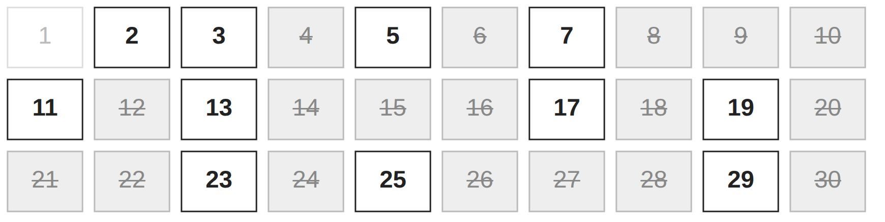

# The sieve of Eratosthenes: finding primes by elimination

<!-- REVIEW 1, 2: State the task explicitly and illustrate prime and nonprime numbers. -->
<!-- REVIEW 25: Replace the inert "list ends with 97" fact; 97 now makes trial division's cost tangible below. -->
Suppose we want to find every prime number up to a chosen integer limit. A
prime is an integer greater than 1 whose only positive divisors are 1 and
itself. For example, 7 is prime; 9 is not, because 3 divides it. How much work
can we save when finding the whole list?

<!-- REVIEW 3, 4: Explain which divisors rule out primality and describe repeated work as increasingly costly. -->
<!-- REVIEW 26: Make the cost concrete with 97 and foreshadow the square-root bound shared by both methods. -->
One reliable approach is **trial division**: take each candidate in turn and
try possible divisors. Finding a divisor other than 1 and the candidate itself
shows that the candidate is not prime: it has a factor that the definition of
a prime rules out. Otherwise, we must check enough possibilities to establish
that the candidate is prime. To confirm 97, we try 2, 3, 4, and so on through
9, and none divides it. We will see later why stopping at 9 is safe.
The next candidate starts a fresh investigation, often involving the same
divisors. As the limit grows, this repeated work becomes increasingly costly.

## Compare the cost

<!-- REVIEW 27: Name the timed trial-division variant and link the benchmark that produced the chart. -->
The chart gives that cost a scale. It compares the sieve implementation we
will develop here with a trial-division implementation that tests each
candidate against every divisor from 2 up to its square root. Each builds
the same complete list of primes at each limit. Follow the two lines as the
limit increases: both times grow, but they pull farther apart.


<!-- REVIEW 5: Clarify the comparison between the growth in the two running times. -->
<!-- REVIEW 6: Remove the benchmark-details paragraph that followed this comparison. -->
<!-- REVIEW 28: Re-measured with benchmark.py; state growth as ratios and keep one sentence of provenance. -->
At a limit of 50,000, trial division took about 64 ms and the sieve about 6 ms.
At 400,000, those times were about 1,194 ms and 58 ms: the sieve took roughly
one twentieth as long. The limit grew eightfold. The sieve's time grew about
tenfold; trial division's grew about nineteenfold. Why does one method keep
roughly in step with the limit while the other runs away from it? We will
return to that question at the end.

The times are medians of seven runs with Python 3.12 on x86-64, measured by
[`benchmark.py`](benchmark.py), which also contains the trial-division code.

## Find the shortcut

<!-- REVIEW 7: Explain that a composite number is therefore not prime. -->
<!-- REVIEW 29: Replace the misleading "Although" with a causal connective. -->
Knowing a factor tells us something about many other numbers at once. Because
`3` is a factor of `3 * 3 = 9`, we know at once that `9` cannot be prime: we
have just constructed it from two factors greater than 1. Such a number is
**composite**, and therefore not prime. We can mark `9` as composite now and
save a separate primality test later.

<!-- REVIEW 30: Credit Eratosthenes briefly. -->
The same observation applies to every larger multiple of 3. We can reach them
directly by counting in threes. This is the shortcut behind the sieve of
Eratosthenes, traditionally credited to the Greek scholar Eratosthenes of
Cyrene in the third century BCE: generate numbers with known factors and cross
them off a list of candidates.

Try the idea on the integers from 2 through 30. Keep 2 and cross out 4, 6, 8,
and the remaining even numbers. This round of crossing out a prime's larger
multiples is an **elimination pass**. The next surviving candidate is 3;
its pass crosses out 6, 9, 12, and so on. Some of those numbers were already
crossed out, but 9, 15, 21, and 27 are newly excluded.

<!-- REVIEW 31: Add a grid so the reader can inspect the state after two passes. -->
<!-- REVIEW 52: Replace the dotted text grid with a diagram that keeps crossed-out numbers visible. -->
After the passes for 2 and 3, the numbers 1 through 30 look like this. Each
crossed-out number is struck through on a grey background, and 1 is faded
because it is not a candidate:



Notice that 25 is the only composite still standing. Neither 2 nor 3 divides
it, so it waits for a pass of its own.

<!-- REVIEW 8: Keep the explanation that the pass for 2 already covered every multiple of 4. -->
There is no need for a pass using 4. Every multiple of 4 was already reached
by the pass for 2. We continue with the next surviving candidate, 5.

<!-- REVIEW 9: Show newly excluded numbers through 30 for each candidate, including the skipped 4. -->
<!-- REVIEW 32: Add the empty pass for 7 and list the survivors, so the stopping question is felt. -->
With the limit fixed at 30, these passes exclude the following new numbers:

| Candidate | Newly excluded numbers |
| --- | --- |
| 2 | 4, 6, 8, 10, 12, 14, 16, 18, 20, 22, 24, 26, 28, 30 |
| 3 | 9, 15, 21, 27 |
| 4 | Skipped—already excluded |
| 5 | 25 |
| 7 | None—14, 21, and 28 are already excluded |

The survivors are 2, 3, 5, 7, 11, 13, 17, 19, 23, and 29. The pass for 7
changed nothing, yet nothing told us in advance that it would not.

The method leaves us with two useful questions. Can a pass skip multiples
already dealt with by smaller primes? And when have we made enough passes
to know that every survivor is prime?

<!-- REVIEW 10: State what unravel assembles in this example. -->
This literate program develops that approach in Python. It assumes familiarity
with Python functions, lists, and loops. The code appears in the order that
develops the argument. In this example, `unravel` assembles a module, a
demonstration, and executable checks in the order Python requires. This
follows the approach in
[A brief introduction to literate programming](../../docs/explanation/literate-programming/literate-programming.md).

## Begin with the result

<!-- REVIEW 33: Tie the promised result to the survivors found by hand. -->
The function `sieve(n)` will return the primes up to and including the integer
bound `n`, in ascending order. Bounds below 2 produce an empty list. For
example, `sieve(30)` should return the survivors we found by hand:
`2, 3, 5, 7, 11, 13, 17, 19, 23, 29`.

The function needs four steps: handle an empty range, prepare the candidates,
cross out the composites, and collect the survivors. We can give those steps
names before working out their details.

<!-- REVIEW 11: Remove the caption and fence explanation; retain named chunks and substitution. -->
{gil: we describe how chunks are used but not how they're defined, as in <<the sieve function>>}
Each named code block is an `unravel` **chunk**. A line such as
`<<prepare the candidate table>>` tells `unravel` to insert that chunk's
contents here, like copying and pasting its code. The definition can appear
later in the document.

*`<<the sieve function>>`* `=`

```python <<the sieve function>>
def sieve(n: int) -> list[int]:
    """Return the primes through integer n, or an empty list when n < 2."""
    <<handle bounds below two>>
    <<prepare the candidate table>>
    <<eliminate the composites>>
    <<collect the surviving primes>>
```

<!-- REVIEW 12: Connect the first check to the list through 30 shown above. -->
<!-- REVIEW 13: Use plain assertions collected into a script, without unittest machinery. -->
The list through 30 shown above gives us a first check on the result. We will
place checks beside the decisions they test, then collect them into a script
at the end. Each `assert` stops the script with an error if its condition is
false.

*`<<sieve checks>>`* `=`

```python <<sieve checks>>
assert sieve(30) == [2, 3, 5, 7, 11, 13, 17, 19, 23, 29]

```

<!-- REVIEW 34: Retitle the section to match its content: where each pass starts. -->
## Start each pass at the square

<!-- REVIEW 15: Use the pass for 5 to distinguish keeping the prime from crossing out its larger multiples. -->
Consider the pass for 5. We keep `5 * 1 = 5`: it is the prime whose multiples
we are crossing out. Starting at `5 * 2 = 10` would take us through
`5 * 3 = 15` and `5 * 4 = 20` before reaching `5 * 5 = 25`. But 10 and 20
are even, and 15 was reached by the pass for 3. The first number this pass
must eliminate is 25.

<!-- REVIEW 35: Justify keeping the name is_prime and forward-reference the table's layout. -->
We will record this information in a table: `is_prime[k]` is `True` while `k`
remains a candidate and `False` once it has been excluded. Until the sieve is
finished, a `True` entry is a possibility, rather than a proof of primality.
We keep the conventional name anyway, because it is accurate where it matters:
by the time the function reads the table to collect its result, `True` means
prime. We will settle the table's layout once the passes are complete.

The starting points now form a pattern: 4 for the pass using 2, 9 for the pass
using 3, and 25 for the pass using 5. Each is the square of the prime. To use
this rule for every pass, we need to explain why it holds.

<!-- REVIEW 14: Use p consistently for the current prime in prose and code. -->
<!-- REVIEW 15: Explain in prose why earlier passes cover the larger multiples below the square. -->
<!-- REVIEW 36: Introduce the smallest prime factor; fix "divisible by one" and close the gap about late-starting earlier passes. -->
One fact explains the pattern, and we will use it again. Every composite
number `m` has a **smallest prime factor**; call it `q`, and write
`m = q * k`. Any prime factor of `k` also divides `m`, so none is smaller than
`q`. Therefore `k` is at least `q`, and `m` is at least `q * q`. A composite is
never smaller than the square of its smallest prime factor.

Now let `p` be the prime for the current pass, and consider a multiple
`m = p * k` with `1 < k < p`. The multiplier `k` is a smaller prime or is
divisible by a smaller prime, so the smallest prime factor `q` of `m` is
smaller than `p`. The earlier pass for `q` started at `q * q` and counted in
steps of `q`; since `m` is a multiple of `q` and at least `q * q`, that pass
has already crossed it out. We can therefore start at `p * p`.

*`<<cross out multiples of this prime>>`* `=`

```python <<cross out multiples of this prime>>
for multiple in range(p * p, n + 1, p):
    is_prime[multiple] = False
```

<!-- REVIEW 16: Explain the sequence range produces and trace the values visited by this loop. -->
<!-- REVIEW 37: Trim the general description of range to the excluded stop, matching the stated audience. -->
Recall that `range(start, stop, step)` stops before `stop`. For `p = 5` and
`n = 30`, our loop uses `range(25, 31, 5)`, so `multiple` takes the values
`25` and `30`. Using `n + 1` as the stop lets the loop include `n` when it is
a multiple of `p`.

<!-- REVIEW 17: Specify that the square is the square of the current prime. -->
<!-- REVIEW 38: Flag repeated marks as the sieve's remaining cost, to be counted at the end. -->
Some later multiples still receive more than one mark: 30, for example, is
reached by 2, 3, and 5. Setting an entry to `False` again does not affect the
result, though it does cost time; we will count these repeated marks at the
end. Starting at the square of the current prime removes the redundant
beginning of each pass.

## Discover when the work is finished

For a limit of 100, the pass for 7 starts at 49. The next surviving candidate
is 11, whose square is 121: already beyond the end of the table. Could a
composite below 100 still be waiting for its first mark?

<!-- REVIEW 39: Use the smallest prime factor so "reached" means "crossed out by its pass". -->
Take any composite at most 100, and let `q` be its smallest prime factor. We
showed that the composite is at least `q * q`, so `q * q` is at most 100 and
`q` is at most 10. The pass for `q` starts at `q * q` and counts in steps of
`q`, so it has already crossed the number out.

The same argument works for any bound `n >= 2`. Every composite through `n`
has a smallest prime factor whose square is at most `n`: a prime no greater
than the square root of `n`. Once we have processed those primes, every
composite has been eliminated. The same reasoning explains why trial division
could stop at 9 when testing 97: had 97 been composite, its smallest prime
factor would have been at most the square root of 97, which is less than 10.

<!-- REVIEW 40: Clarify the column header and add the row that shows the boundary. -->
For the limit 100, the square-root boundary is 10:

| Prime | First multiple this pass crosses out |
| --- | --- |
| 2 | 4 |
| 3 | 9 |
| 5 | 25 |
| 7 | 49 |
| 11 | 121, beyond 100: no pass needed |

Finding every prime through 100 therefore requires elimination passes for only
four numbers: 2, 3, 5, and 7. The other candidates through 10 have already been
eliminated. After those four passes, every remaining number greater than 1 is
prime. Larger survivors such as 11 and 97 can be collected without performing
their own passes.

<!-- REVIEW 18: Name the chunk for its purpose: make isqrt available. -->
<!-- REVIEW 41: Name the rejected floating-point alternative and why exactness matters. -->
Python's `isqrt(n)` gives the greatest integer no larger than the square root
of `n`, using exact integer arithmetic. It supplies the boundary for our loop.
The tempting alternative, `int(n ** 0.5)`, goes through a floating-point
approximation and can be off by one for large `n`: for
`n = 10**16 + 2 * 10**8` it returns 100000001 instead of 100000000. An
overestimate here would only add a pass that crosses out nothing, but an exact
boundary lets us rely on the argument above without asking whether rounding
could ever err in the other direction.

*`<<make isqrt available>>`* `=`

```python <<make isqrt available>>
from math import isqrt
```

<!-- REVIEW 42: Reserve "mark" for crossing out; say a candidate has "survived". -->
We examine candidates in increasing order. If a candidate has survived, none
of the smaller primes divides it, so it is prime and can eliminate its
multiples. A candidate already crossed out contributes no new work.

*`<<eliminate the composites>>`* `=`

```python <<eliminate the composites>>
for p in range(2, isqrt(n) + 1):
    if is_prime[p]:
        <<cross out multiples of this prime>>
```

<!-- REVIEW 19: Name the chunk reference and explain how its indentation is preserved. -->
Here `unravel` expands `<<cross out multiples of this prime>>`, preserving
its indentation and placing the marking loop inside the `if` block.

The `+ 1` matters at the boundary. With a limit of 49, stopping before 7
would leave 49 unmarked. Since `range` excludes its upper bound, we add 1
to ensure that the pass for 7 runs. The next check protects that decision.

<!-- REVIEW 43: Explain the trailing blank line inside each group of checks. -->
Using the name `sieve checks` again adds to the earlier chunk. `unravel`
combines these definitions in document order wherever that chunk is referenced.
A group of checks ends with a blank line when another group follows, so the
generated script keeps the groups visibly separate.

*`<<sieve checks>>`* `=` (continued)

```python <<sieve checks>>
for square in (4, 9, 25, 49, 121):
    assert square not in sieve(square)

```

## Give each candidate a place

<!-- REVIEW 20: Name the is_prime table explicitly. -->
<!-- REVIEW 21: Use the table's name to connect the explanation to the code. -->
We now know how to cross out composites and when to stop. The `is_prime`
table itself can stay simple: let each integer serve as its own address.
For `n >= 2`, `n + 1` entries give us indices from 0 through `n`. Mark 0 and 1
as excluded immediately, since neither is prime; every other entry starts as
a candidate.

*`<<prepare the candidate table>>`* `=`

```python <<prepare the candidate table>>
is_prime = [True] * (n + 1)
is_prime[0] = is_prime[1] = False
```

This representation uses space proportional to `n`. It makes each mark and
lookup straightforward, at the cost of retaining a place for every integer up
to the bound.

<!-- REVIEW 44: Name the actual failure the guard prevents and state the int contract. -->
One small case needs attention before we create the table. A bound below 2
has no primes, so we can return an empty list immediately. Without this guard,
`[True] * (n + 1)` would build a list too short for indices 0 and 1:
`sieve(0)` would raise `IndexError` at `is_prime[1]`, and a negative bound
would raise it at `is_prime[0]`. The function outline already puts this guard
first, although its definition appears here. The function expects an `int`;
other argument types are outside its contract.

*`<<handle bounds below two>>`* `=`

```python <<handle bounds below two>>
if n < 2:
    return []
```

*`<<sieve checks>>`* `=` (continued)

```python <<sieve checks>>
for bound in (-100, -1, 0, 1):
    assert sieve(bound) == []

```

## Read what remains

<!-- REVIEW 45: Cite the smallest-prime-factor argument for "no composite has escaped". -->
What remains in the table? No prime has been crossed out: every mark was
made at a product of factors greater than 1. No composite has escaped: its
smallest prime factor is no greater than the square root of `n`, and that
prime's pass crossed it out. Those two facts settle the original question.
The surviving entries are exactly the primes.

Scanning their indices in increasing order produces the promised sorted list.
Again, the stop `n + 1` makes the bound inclusive.

*`<<collect the surviving primes>>`* `=`

```python <<collect the surviving primes>>
return [number for number in range(2, n + 1) if is_prime[number]]
```

<!-- REVIEW 46: Say why 2 and 3 run no elimination passes. -->
In particular, a prime bound must survive as the last element of the result.
The smallest cases, 2 and 3, also exercise a sieve with no elimination passes:
for both, `isqrt(n) + 1` is 2, so the elimination loop never runs.

*`<<sieve checks>>`* `=` (continued)

```python <<sieve checks>>
for p in (2, 3, 29, 97):
    assert sieve(p)[-1] == p
```

## Assemble the program after explaining it

<!-- REVIEW 22: Move the independent trial-division comparison from the example to repository tests. -->
<!-- REVIEW 23: Explain why the function needs a small calling program. -->
<!-- REVIEW 47: Point readers to the repository test that compares the sieve with trial division. -->
We have developed the function in the order of its decisions: how to eliminate
composites, when to stop, and what to keep. A small calling program will now
let us run it.

The checks in this document illustrate particular decisions. The repository's
[example tests](../../tests/test_examples.py) supply broader evidence: they
compare `sieve` with a direct trial-division definition for every bound from
-5 through 200.

Three final chunks arrange the code for Python. `sieve.py` puts the import
before the function; `main.py` calls the function with a limit of 100;
`check_sieve.py` collects the assertions into a script.

Each file shares a copyright, license, and generated-file notice, defined once
and reused below.

*`<<generated file notice>>`* `=`

```python <<generated file notice>>
# Copyright (C) 2026 Gil Hauer
# SPDX-License-Identifier: GPL-3.0-only
# See LICENSE in the project root for the full license text.
# Generated from sieve.md by unravel; edit the Markdown source and regenerate.
```

The chunk named `sieve.py` defines an output file. Its references insert the
notice, import, and function in the order shown.

*`<<sieve.py>>`* `=`

```python <<sieve.py>>
<<generated file notice>>

<<make isqrt available>>


<<the sieve function>>
```

<!-- REVIEW 48: Introduce the two remaining files and explain how their import resolves. -->
`main.py` and `check_sieve.py` import the function from the neighboring
`sieve.py`. Python finds it because it adds a script's own directory to
`sys.path`, so the commands below work from the repository root.

*`<<main.py>>`* `=`

```python <<main.py>>
<<generated file notice>>

from sieve import sieve


if __name__ == "__main__":
    print(sieve(100))
```

*`<<check_sieve.py>>`* `=`

```python <<check_sieve.py>>
<<generated file notice>>

from sieve import sieve


if __name__ == "__main__":
    <<sieve checks>>
```

## Generate, run, and verify

From the repository root, use the checked-out version of `unravel` through `uv`:

```bash
uv run unravel examples/sieve/sieve.md -o examples/sieve/generated
uv run python examples/sieve/generated/main.py
uv run python examples/sieve/generated/check_sieve.py
```

The demonstration prints:

```text
[2, 3, 5, 7, 11, 13, 17, 19, 23, 29, 31, 37, 41, 43, 47, 53, 59, 61, 67, 71, 73, 79, 83, 89, 97]
```

<!-- REVIEW 24: Remove the obsolete --check explanation and retain the manifest's role in regeneration. -->
<!-- REVIEW 49: Say what success looks like for the checks, and warn about python -O. -->
The generated checks exercise the program's behavior. `check_sieve.py` prints
nothing when every check passes and exits with status 0; a failing check stops
the script with an `AssertionError` that names its line. Run it without
Python's `-O` option, which removes `assert` statements.

<!-- REVIEW 50: Introduce the tree and include every file in the example directory. -->
The example directory holds the source document, the benchmark and chart
behind "Compare the cost", and the generated files:

```text
examples/sieve/
├── sieve.md
├── benchmark.py
├── diagrams/
│   └── runtime-comparison.mmd
├── png/
│   └── runtime-comparison.png
└── generated/
    ├── .unravel-manifest.json
    ├── check_sieve.py
    ├── main.py
    └── sieve.py
```

Edit `sieve.md` and regenerate to change the example. Keep the manifest with
the generated files when using `unravel` to update them; Python can
run the generated program independently of the document and manifest.

<!-- REVIEW 51: Add a closing section that answers the opening question, revisits the chart, and offers next questions. -->
## What the sieve saved

We began by asking how much work the sieve saves. Trial division spends its
effort on each candidate separately. A composite usually reveals a small
divisor quickly, but every prime `k` must survive about the square root of
`k` divisions. With roughly `n / ln n` primes up to `n`, the total grows
roughly like `n * sqrt(n) / ln n`.

The sieve spends its effort on composites instead. The pass for prime `p`
crosses out about `n / p` entries, and a composite is crossed out once for
each distinct prime factor whose square does not exceed it: the repeated
marks we noticed earlier. Summed over those primes, the total grows like
`n * ln(ln n)`, which is barely faster than `n` itself.

These estimates describe how the work grows, not how many milliseconds it
takes. Between the chart's limits of 50,000 and 400,000, they predict that
trial division's time should grow about nineteenfold and the sieve's about
ninefold. The measurements showed about nineteenfold and tenfold. That
agreement is evidence consistent with the analysis, not a proof of it. The
estimates ignore interpreter overhead and memory effects, and a different
machine would produce different times.

The saving has a price. The sieve needs the bound in advance and a table with
a place for every integer up to it. Trial division can test a single number in
isolation and needs almost no memory. To find every prime up to a limit, the
sieve's trade is worth it; to ask whether one large number is prime, it is not.

A few variations are worth trying. Even numbers other than 2 are never prime,
so a table of odd numbers alone halves both the space and the work; how do the
indices change? A `bytearray` stores each entry in one byte rather than a
pointer-sized list slot. And when the table itself is too large to hold in
memory, a **segmented sieve** processes the range in blocks, reusing the primes
up to the square root of `n` for each one. Which of the arguments in this
document would each variation need to revisit?
