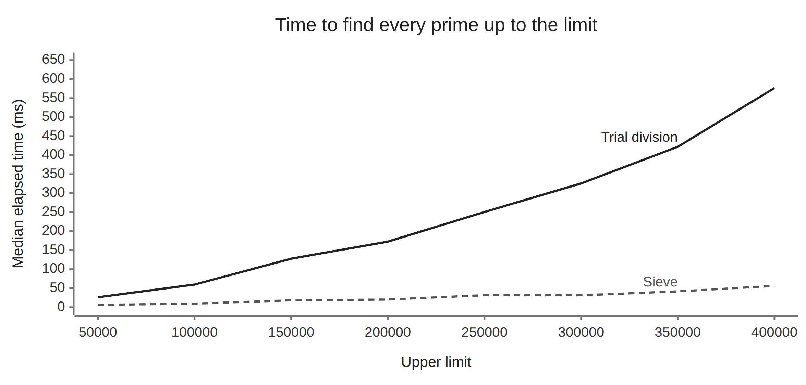

# The sieve of Eratosthenes: finding primes by elimination

<!-- REVIEW 1, 2: State the task explicitly and illustrate prime and nonprime numbers. -->
Suppose we want to find every prime number up to a chosen integer limit. A
prime is an integer greater than 1 whose only positive divisors are 1 and
itself. For example, 7 is prime; 9 is not, because 3 divides it. Through 100,
the list ends with 97. How much work can we save when finding the whole list?

<!-- REVIEW 3, 4: Explain which divisors rule out primality and describe repeated work as increasingly costly. -->
One reliable approach is **trial division**: take each candidate in turn and
try possible divisors. Finding a divisor other than 1 and the candidate itself
shows that the candidate is not prime: it has a factor that the definition of
a prime rules out. Otherwise, we must check enough possibilities to establish
that the candidate is prime.
The next candidate starts a fresh investigation, often involving the same
divisors. As the limit grows, this repeated work becomes increasingly costly.

## Compare the cost

The chart gives that cost a scale. It compares the sieve implementation we
will develop here with a separate trial-division implementation. Each builds
the same complete list of primes at each limit. Follow the two lines as the
limit increases: both times grow, but they pull farther apart.



<!-- REVIEW 5: Clarify the comparison between the growth in the two running times. -->
<!-- REVIEW 6: Remove the benchmark-details paragraph that followed this comparison. -->
At a limit of 50,000, trial division took about 26 ms and the sieve about 6 ms.
At 400,000, those times were about 577 ms and 56 ms: the sieve took roughly
one tenth as long. Both methods needed more time as the limit increased;
trial division's time grew much faster.

## Find the shortcut

<!-- REVIEW 7: Explain that a composite number is therefore not prime. -->
Knowing a prime tells us something about many other numbers at once. Although
`3` is prime, `3 * 3` gives `9`, which cannot be prime: we have just constructed
it from two factors greater than 1. Such a number is **composite**, and therefore
not prime. We can mark `9` as composite now and save a separate primality test
later.

The same observation applies to every larger multiple of 3. We can reach them
directly by counting in threes. This is the shortcut behind the sieve of
Eratosthenes: generate numbers with known factors and cross them off a list
of candidates.

Try the idea on the integers from 2 through 30. Keep 2 and cross out 4, 6, 8,
and the remaining even numbers. This round of marking a prime's larger
multiples is an **elimination pass**. The next surviving candidate is 3;
its pass crosses out 6, 9, 12, and so on. Some of those numbers were already
crossed out, but 9, 15, 21, and 27 are newly excluded.

<!-- REVIEW 8: Keep the explanation that the pass for 2 already covered every multiple of 4. -->
There is no need for a pass using 4. Every multiple of 4 was already reached
by the pass for 2. We continue with the next surviving candidate, 5.

<!-- REVIEW 9: Show newly excluded numbers through 30 for each candidate, including the skipped 4. -->
With the limit fixed at 30, these passes exclude the following new numbers:

| Candidate | Newly excluded numbers |
| --- | --- |
| 2 | 4, 6, 8, 10, 12, 14, 16, 18, 20, 22, 24, 26, 28, 30 |
| 3 | 9, 15, 21, 27 |
| 4 | Skipped—already excluded |
| 5 | 25 |

The method leaves us with two useful questions. Can a pass skip multiples
already dealt with by smaller primes? And when have we made enough passes
to know that every survivor is prime?

<!-- REVIEW 10: State what unravel assembles in this example. -->
This literate program develops that approach in Python. It assumes familiarity
with Python functions, lists, and loops. The code appears in the order that
develops the argument. In this example, `unravel` assembles a module, a
demonstration, and executable checks in the order Python requires. This
follows the approach in
[A brief introduction to literate programming](../../docs/explanation/literate-programming/literate-programming.md).

## Begin with the result

The function `sieve(n)` will return the primes up to and including the integer
bound `n`, in ascending order. Bounds below 2 produce an empty list. For
example, the primes through 30 are `2, 3, 5, 7, 11, 13, 17, 19, 23, 29`.

The function needs four steps: handle an empty range, prepare the candidates,
cross out the composites, and collect the survivors. We can give those steps
names before working out their details.

<!-- REVIEW 11: Remove the caption and fence explanation; retain named chunks and substitution. -->
Each named code block is an `unravel` **chunk**. A line such as
`<<prepare the candidate table>>` tells `unravel` to insert that chunk's
contents here, like copying and pasting its code. The definition can appear
later in the document.

*`<<the sieve function>>`* `=`

```python <<the sieve function>>
def sieve(n: int) -> list[int]:
    """Return the primes through integer n, or an empty list when n < 2."""
    <<handle bounds below two>>
    <<prepare the candidate table>>
    <<eliminate the composites>>
    <<collect the surviving primes>>
```

<!-- REVIEW 12: Connect the first check to the list through 30 shown above. -->
<!-- REVIEW 13: Use plain assertions collected into a script, without unittest machinery. -->
The list through 30 shown above gives us a first check on the result. We will
place checks beside the decisions they test, then collect them into a script
at the end. Each `assert` stops the script with an error if its condition is
false.

*`<<sieve checks>>`* `=`

```python <<sieve checks>>
assert sieve(30) == [2, 3, 5, 7, 11, 13, 17, 19, 23, 29]

```

## Let composites identify themselves

<!-- REVIEW 15: Use the pass for 5 to distinguish keeping the prime from crossing out its larger multiples. -->
Consider the pass for 5. We keep `5 * 1 = 5`: it is the prime whose multiples
we are crossing out. Starting at `5 * 2 = 10` would take us through
`5 * 3 = 15` and `5 * 4 = 20` before reaching `5 * 5 = 25`. But 10 and 20
are even, and 15 was reached by the pass for 3. The first number this pass
must eliminate is 25.

We will record this information in a table: `is_prime[k]` is `True` while `k`
remains a candidate and `False` once it has been excluded. Until the sieve is
finished, a `True` entry is a possibility, rather than a proof of primality.

The starting points now form a pattern: 4 for the pass using 2, 9 for the pass
using 3, and 25 for the pass using 5. Each is the square of the prime. To use
this rule for every pass, we need to explain why it holds.

<!-- REVIEW 14: Use p consistently for the current prime in prose and code. -->
<!-- REVIEW 15: Explain in prose why earlier passes cover the larger multiples below the square. -->
Let `p` be any prime. Every larger multiple of `p` below `p * p` has a
multiplier smaller than `p`. That multiplier is either a smaller prime or
divisible by one, so an earlier pass has already crossed out the multiple.
We can therefore start at `p * p`.

*`<<cross out multiples of this prime>>`* `=`

```python <<cross out multiples of this prime>>
for multiple in range(p * p, n + 1, p):
    is_prime[multiple] = False
```

<!-- REVIEW 16: Explain the sequence range produces and trace the values visited by this loop. -->
Python's `range` produces a sequence of integers that a `for` loop visits one
at a time. In `range(start, stop, step)`, the values begin at `start`, advance
by `step`, and stop before `stop`.

For `p = 5` and `n = 30`, our loop uses `range(25, 31, 5)`, so `multiple`
takes the values `25` and `30`. Using `n + 1` as the stop lets the loop
include `n` when it is a multiple of `p`.

<!-- REVIEW 17: Specify that the square is the square of the current prime. -->
Some later multiples still receive more than one mark: 30, for example, is
reached by 2, 3, and 5. Setting an entry to `False` again is harmless. Starting
at the square of the current prime removes the redundant beginning of each
pass.

## Discover when the work is finished

For a limit of 100, the pass for 7 starts at 49. The next surviving candidate
is 11, whose square is 121: already beyond the end of the table. Could a
composite below 100 still be waiting for its first mark?

Any composite at most 100 has two factors greater than 1. They cannot both
exceed 10, because their product would then exceed 100. At least one factor
is at most 10; if that factor is composite, it in turn has a prime divisor
no larger than itself. A prime at most 10 must therefore have reached the
number already.

The same argument works for any bound `n >= 2`. If both factors exceeded the
square root of `n`, their product would exceed `n`. Every composite through
`n` must therefore have a prime divisor no greater than that square root.
Once we have processed those primes, every composite has been eliminated.

For the limit 100, the square-root boundary is 10:

| Prime used for a pass | First multiple that needs this pass |
| --- | --- |
| 2 | 4 |
| 3 | 9 |
| 5 | 25 |
| 7 | 49 |

Finding every prime through 100 therefore requires elimination passes for only
four numbers: 2, 3, 5, and 7. The other candidates through 10 have already been
eliminated. After those four passes, every remaining number greater than 1 is
prime. Larger survivors such as 11 and 97 can be collected without performing
their own passes.

<!-- REVIEW 18: Name the chunk for its purpose: make isqrt available. -->
Python's `isqrt(n)` gives the greatest integer no larger than the square root
of `n`, using exact integer arithmetic. It supplies the boundary for our loop.

*`<<make isqrt available>>`* `=`

```python <<make isqrt available>>
from math import isqrt
```

We examine candidates in increasing order. If a candidate is still marked,
none of the smaller primes divides it, so it is prime and can eliminate its
multiples. A candidate already crossed out contributes no new work.

*`<<eliminate the composites>>`* `=`

```python <<eliminate the composites>>
for p in range(2, isqrt(n) + 1):
    if is_prime[p]:
        <<cross out multiples of this prime>>
```

<!-- REVIEW 19: Name the chunk reference and explain how its indentation is preserved. -->
Here `unravel` expands `<<cross out multiples of this prime>>`, preserving
its indentation and placing the marking loop inside the `if` block.

The `+ 1` matters at the boundary. With a limit of 49, stopping before 7
would leave 49 unmarked. Since `range` excludes its upper bound, we add 1
to ensure that the pass for 7 runs. The next check protects that decision.

Using the name `sieve checks` again adds to the earlier chunk. `unravel`
combines these definitions in document order wherever that chunk is referenced.

*`<<sieve checks>>`* `=` (continued)

```python <<sieve checks>>
for square in (4, 9, 25, 49, 121):
    assert square not in sieve(square)

```

## Give each candidate a place

<!-- REVIEW 20: Name the is_prime table explicitly. -->
<!-- REVIEW 21: Use the table's name to connect the explanation to the code. -->
We now know how to cross out composites and when to stop. The `is_prime`
table itself can stay simple: let each integer serve as its own address.
For `n >= 2`, `n + 1` entries give us indices from 0 through `n`. Mark 0 and 1
as excluded immediately, since neither is prime; every other entry starts as
a candidate.

*`<<prepare the candidate table>>`* `=`

```python <<prepare the candidate table>>
is_prime = [True] * (n + 1)
is_prime[0] = is_prime[1] = False
```

This representation uses space proportional to `n`. It makes each mark and
lookup straightforward, at the cost of retaining a place for every integer up
to the bound.

One small case needs attention before we create the table. A bound below 2
has no primes, so we can return an empty list immediately. This also keeps
negative values away from `isqrt` and ensures that indices 0 and 1 exist when
we initialize the table. The function outline already puts this guard first,
although its definition appears here.

*`<<handle bounds below two>>`* `=`

```python <<handle bounds below two>>
if n < 2:
    return []
```

*`<<sieve checks>>`* `=` (continued)

```python <<sieve checks>>
for bound in (-100, -1, 0, 1):
    assert sieve(bound) == []

```

## Read what remains

What remains in the table? No prime has been crossed out: every mark was
made at a product of factors greater than 1. No composite has escaped: each
has a prime divisor within the boundary we processed. Those two facts settle
the original question. The surviving entries are exactly the primes.

Scanning their indices in increasing order produces the promised sorted list.
Again, the stop `n + 1` makes the bound inclusive.

*`<<collect the surviving primes>>`* `=`

```python <<collect the surviving primes>>
return [number for number in range(2, n + 1) if is_prime[number]]
```

In particular, a prime bound must survive as the last element of the result.
The smallest cases, 2 and 3, also exercise a sieve with no elimination passes.

*`<<sieve checks>>`* `=` (continued)

```python <<sieve checks>>
for p in (2, 3, 29, 97):
    assert sieve(p)[-1] == p
```

## Assemble the program after explaining it

<!-- REVIEW 22: Move the independent trial-division comparison from the example to repository tests. -->
<!-- REVIEW 23: Explain why the function needs a small calling program. -->
We have developed the function in the order of its decisions: how to eliminate
composites, when to stop, and what to keep. A small calling program will now
let us run it.

Three final chunks arrange the code for Python. `sieve.py` puts the import
before the function; `main.py` calls the function with a limit of 100;
`check_sieve.py` collects the assertions into a script.

Each file shares a copyright, license, and generated-file notice, defined once
and reused below.

*`<<generated file notice>>`* `=`

```python <<generated file notice>>
# Copyright (C) 2026 Gil Hauer
# SPDX-License-Identifier: GPL-3.0-only
# See LICENSE in the project root for the full license text.
# Generated from sieve.md by unravel; edit the Markdown source and regenerate.
```

The chunk named `sieve.py` defines an output file. Its references insert the
notice, import, and function in the order shown.

*`<<sieve.py>>`* `=`

```python <<sieve.py>>
<<generated file notice>>

<<make isqrt available>>


<<the sieve function>>
```

*`<<main.py>>`* `=`

```python <<main.py>>
<<generated file notice>>

from sieve import sieve


if __name__ == "__main__":
    print(sieve(100))
```

*`<<check_sieve.py>>`* `=`

```python <<check_sieve.py>>
<<generated file notice>>

from sieve import sieve


if __name__ == "__main__":
    <<sieve checks>>
```

## Generate, run, and verify

From the repository root, use the checked-out version of `unravel` through `uv`:

```bash
uv run unravel examples/sieve/sieve.md -o examples/sieve/generated
uv run python examples/sieve/generated/main.py
uv run python examples/sieve/generated/check_sieve.py
```

The demonstration prints:

```text
[2, 3, 5, 7, 11, 13, 17, 19, 23, 29, 31, 37, 41, 43, 47, 53, 59, 61, 67, 71, 73, 79, 83, 89, 97]
```

<!-- REVIEW 24: Remove the obsolete --check explanation and retain the manifest's role in regeneration. -->
The generated checks exercise the program's behavior.

```text
examples/sieve/
├── sieve.md
└── generated/
    ├── .unravel-manifest.json
    ├── check_sieve.py
    ├── main.py
    └── sieve.py
```

Edit `sieve.md` and regenerate to change the example. Keep the manifest with
the generated files when using `unravel` to update them; Python can
run the generated program independently of the document and manifest.
